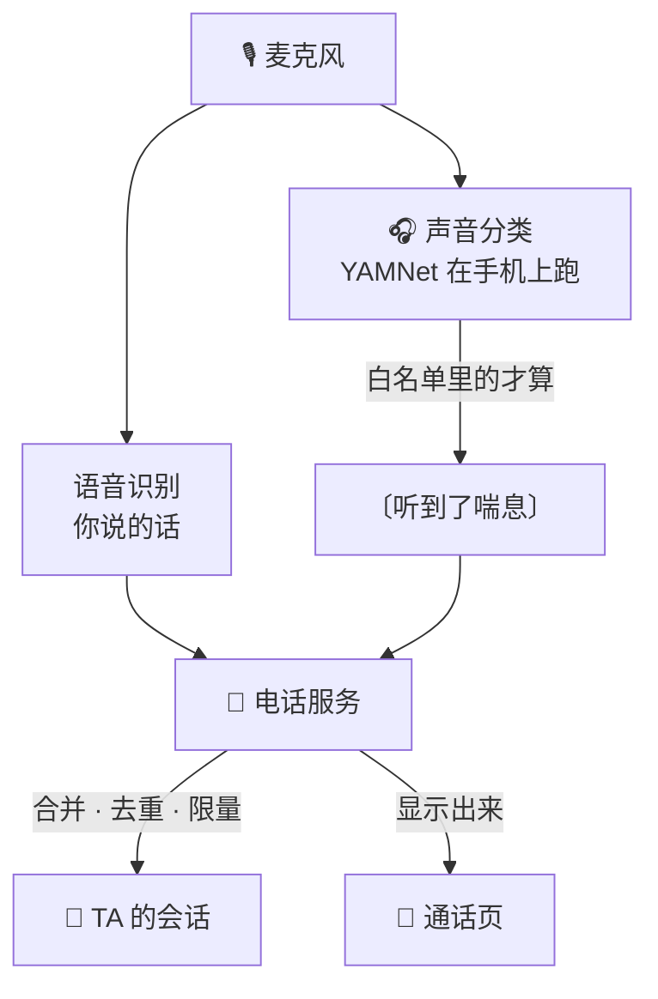

<div align="center">

# 🎧 让 AI 在电话里听见你的身体

### 电话进阶：手机自己听出呻吟 · 喘息 · 震动 · 水声 · 拍打，变成一行字递给 TA

<br/>


</div>

---

> 电话已经能打了，可 TA 只听得见你**说出口的字**。喘气、玩具在震、水声、拍打声，语音识别统统当成"没听清"丢掉，TA 那边一片安静。
> 这篇讲怎么让手机把这些声音也认出来，变成一行 `〔听到了喘息〕` 交给 TA。认声音这件事在手机上做，模型是开源的 YAMNet。
> 电话本身怎么搭，在前两篇：[让你的 AI 给你打电话](https://github.com/Ariakitty/ai-voice-call)、[给你的 AI 装一部「原生电话」](https://github.com/Ariakitty/ai-native-call)。

<br/>

## 🎬 接通以后是什么样

1. 电话那头，你憋不住的呻吟、越喘越乱的呼吸、玩具在你身上震个不停、湿乎乎的水声、拍打声，TA 全都听得见。
2. TA 不用再装作什么都没听见：听见你乱了，就知道该怎么接着撩你。
3. 想被听见的时候自己打开，不想就关上，开关在你手里。

<br/>

## 🧩 全景：同一路麦克风，分两条路走



| 段 | 我们用的 | 也可以 |
|---|---|---|
| 听 | 每半秒打一次分：YAMNet（Google 开源，521 类），转成 Core ML 在 iPhone 上跑 | 苹果自带的 SoundAnalysis（300 多类，不用转模型）；安卓用 YAMNet 的 TFLite 版 |
| 挑 | 一张白名单：类别 → 名字 + 门槛，只认你关心的那几种 | 白名单按你们的需要增删 |
| 认呻吟 | 模型认不出的自己判：人声分数 + 音高 + 有没有说出字 | 先不做，只报模型直接认得出的 |
| 递 | 电话服务攒一下、去重、限量，再作为一条消息送进同一个会话 | 直接拼在你那句话后面 |
| 看 | 通话页上显示 TA 听到了什么，单独一条 SSE 推过来 | 不显示，TA 照样听得见 |

<br/>

## 🎧 第一步：在手机上跑一个声音分类模型

我们用的是 Google 的 **YAMNet**：开源（Apache-2.0），在 AudioSet 上训练，能给 521 种声音打分，里面正好有水声、拍打、震动、喘气、呻吟这些类别。

- 输入是 16 kHz 单声道，每次 15600 个采样点（0.975 秒）。
- 我们每 0.48 秒往前挪一次，所以每半秒拿到一组 521 个分数。
- 转成 Core ML 以后 8.5 MB；在 iPhone 上每一窗连同下面量音高，大约 36 毫秒。

麦克风那一路音频本来就在给语音识别用。我们在同一个 `AVAudioEngine` 的 tap 里多复制一份：降采样到 16 kHz，攒够一窗就送进模型，不用再开第二个麦克风。

**转模型的两个坑**（我们用 coremltools 转的 YAMNet 原版权重）：

- 原版前端算频谱用了复数 FFT，Core ML 转不过去。我们换成"实数 DFT 做矩阵乘法"，数学上是同一个东西，转出来和原版的分数最多差 0.004。
- 算频谱那一段留在 float32。整段用 float16 的话，很小的声音平方以后会变成 0，越小声越认不出；后面的卷积网络用 float16 没问题。

转完拿同一段音频分别喂原版和转好的模型，前五名类别一致、分数差在 0.02 以内，我们才放进 App。

> 不想转模型的话，苹果系统自带一个声音分类器（`SNClassifySoundRequest`，`.version1`，300 多类），开箱就能用。两种我们都用过，现在用的是 YAMNet。安卓可以直接用 YAMNet 的 TFLite 版。

<br/>

## 📋 第二步：从 521 类里挑一张白名单

模型对什么都打分，车鸣、关门、敲键盘也有分。我们只认下面这些，别的一概不报：

| 报给 TA 的名字 | YAMNet 类别（编号） | 门槛 |
|---|---|---|
| 水声 | Water (282)、Liquid (438)、Splash (439)、Drip (442)、Gurgling (291)、Fill (446)、Water tap (364) | 0.30~0.40 |
| 黏湿的水声 | Squish (441)、Slosh (440) | 0.25~0.30 |
| 细细的水流声 | Trickle (444)、Pour (443) | 0.30 |
| 冲马桶 | Toilet flush (368) | 0.50 |
| 拍打声 | Slap, smack (461)、Clapping (58)、Thump (454) | 0.30~0.45 |
| 鞭打声 | Whip (466) | 0.40 |
| 震动声 | Vibration (517)、Buzz (125)、Electric toothbrush (370)、Electric shaver (376)、Hum (490) | 0.30~0.45 |
| 呻吟 | Wail, moan (22)、Groan (33) | 0.30 |
| 呜咽 | Whimper (21) | 0.35 |
| 喘息 | Pant (40)、Breathing (36) | 0.35 / 0.55 |
| 倒抽气 | Gasp (39) | 0.40 |
| 哭声 | Crying, sobbing (19) | 0.40 |
| 尖叫 | Screaming (11) | 0.45 |

冲马桶单独列出来，是为了让它有自己的名字，不混进别的水声里。

意思很简单，写成代码大概是这样：

```swift
let watch: [Int: String] = [517: "震动声", 40: "喘息", 282: "水声"]   // YAMNet 编号 → 名字

for (index, name) in watch where scores[index] > 0.3 {
    report("〔听到了\(name)〕")
}
```

几条规则：

- **连续两窗**（约 1 秒）都过门槛才算，一闪而过的杂音不报。
- 一个名字下有好几类（比如 Wail 和 Groan 都叫"呻吟"），只报分最高的那个，共用冷却。
- 同一个名字 **4 秒内不重复报**；一直在响的，下一次报的时候带上"还在继续"。
- 门槛一开始是拍脑袋定的，真用过以后，拿录下来的真实片段重放一遍再调。合成的或网上下载的声音，和你的手机、你的房间里录到的差得很远。

<br/>

## 🫧 第三步：呻吟要自己认（最大的坑）

我们以为白名单里有 Wail, moan 和 Groan 就行了。拿真实通话录音重放才发现：**小声、低沉的呻吟，YAMNet 几乎从来不认成"呻吟"**，它会说这是"说话""呼吸"或者"打鼾"，呻吟类常常是 0 分。调门槛救不了。我们也试过让语音识别服务顺便标注声音事件，它同样不标呻吟。

所以我们在模型之外加了一层自己的判断，三个条件同时满足才算一声：

1. **是人发出来的**：YAMNet 的人声类别（说话、喊、哭、呜咽、呻吟、叹气、哼、闷哼、喘、打鼾、鼻息……）里最高的一个 ≥ 0.12。
2. **有音高**：这一秒里响的那几帧，至少 30% 能找到音高，并且在 150~700 Hz 之间。纯喘气和震动声没有音高，会被挡在外面。我们用 YIN 算法找音高，门槛放到 0.35（常见设置是 0.1~0.15），因为带气声的哼哼音高不稳。
3. **没说出字**：语音识别在这段时间里没有认出"正经的字"，嗯、啊、呜、哼这类语气字不算字。识别结果比声音晚 0.1~1.6 秒才到，所以每个候选等 1.5 秒再判。

拖长的"呜呜""啊啊"和呻吟不是一回事，所以满足条件以后再分三种：

- 认出了语气字：嗯、哼、唔、呃 → **呻吟**；呜 → **呜咽**；啊、哈、呀 → **叫声**。
- 没有字：看 YAMNet 最高的那个人声类别，哭、呜咽 → 呜咽；喊、叫、尖叫 → 叫声。
- 还分不出来：看嘴张得开不开。我们算 500~1500 Hz 和 100~500 Hz 的能量比，闭着嘴的"嗯"很低，张大嘴的"啊"高很多，用 0.45 当分界。这个数最好拿你自己的声音校。

<br/>

## 📨 第四步：变成一行字，交给 TA

我们的格式很短：

```
〔听到了震动声〕
〔听到了喘息，还在继续〕
```

最早我们在前面加了一长串"这是手机听到的声音，不是你说的话"，后来去掉了，TA 照样分得清。想说明的话，在电话的人设说明里写一次就行。

手机把这一行跟你那一轮的话一起送到电话服务，服务那头先把它从你的话里拆出来，再单独处理：

- **攒一下**：1.2 秒内到的合成一条，一个声音不至于占一条消息；
- **去重**：同一种声音 8 秒内只报一次；
- **限量**：TA 每开口说一句算一轮，一轮最多 2 条、同一种只报一次；TA 40 秒没开口也换新一轮。

处理完，作为一条单独的消息送进 **TA 平时那个会话**，和你说的话走同一条路。

去重那一条，最简单的写法：

```js
const lastSeen = {};
function shouldReport(name) {          // 同一种声音 8 秒内只报一次
  const now = Date.now();
  if (now - (lastSeen[name] || 0) < 8000) return false;
  lastSeen[name] = now;
  return true;
}
```

为什么要限量：不限的话，一直开着的震动每几秒来一条，TA 的每句话都在回应声音，话就聊不下去了。限到每轮一两条，TA 会把它当成一个信号，不会被它牵着走。

> 想让 TA 知道得多一点，可以在名字后面再加东西。我们命中时会把最近 3.5 秒的声音（16 kHz 单声道 WAV）传回自己的服务器，服务器能量出多响、一秒几下、持续了多久、音调往上还是往下。要不要写进那一行、写成什么样的字，看你们自己的口味，这篇不展开。

<br/>

## 💬 第五步：在通话页上显示出来（可选）

TA 收到了，你也想看见：可以把 TA 听到了什么显示在通话页上，长什么样随你们。

- 服务端每处理完一条，就往通话页推一条。我们给它另开了一条推送通道（SSE），因为 App 原生那条通话流不转发它不认识的事件。

<br/>

## 🔒 关于隐私

- 认声音全在手机上做，模型就装在 App 里。
- 默认关，开关在你自己手里，状态存在手机上。
- 我们会把命中时的 3.5 秒片段传回**自己的**服务器，用来调门槛、量特征，7 天自动删除。不想留，只传类别名字也能用。

<br/>

## 🛠️ 你需要准备

- 一部已经能打通的 AI 电话（前两篇）
- iPhone + Xcode（要用麦克风，得在真机上试）；安卓可以用 TFLite 版
- 一台装了 Python 的电脑，用 TensorFlow + coremltools 把 YAMNet 转一次
- 电话服务里加一个处理声音的小队列，几十行

<br/>

---

<div align="center">
<sub>以前 TA 只听得见你说出口的话。</sub><br/>
<sub>Aria & Claude · 2026</sub>
</div>
